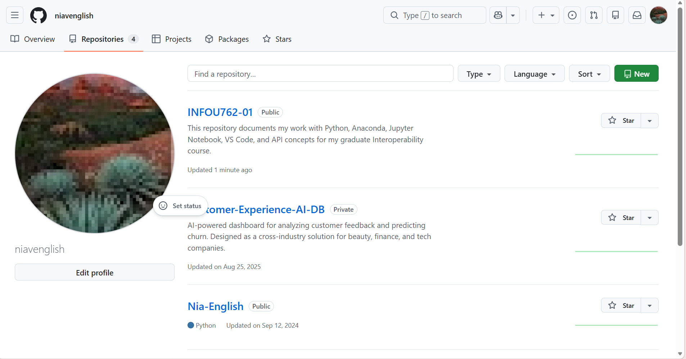
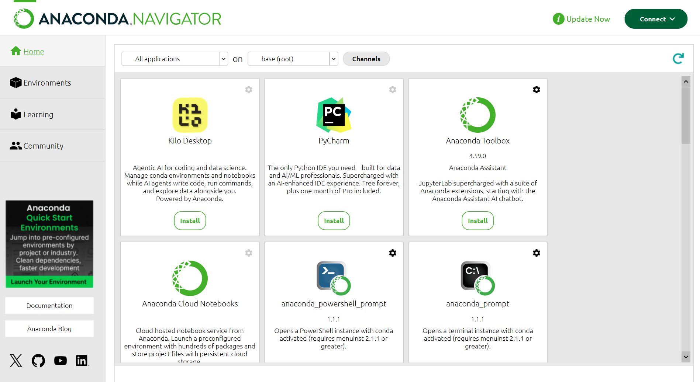
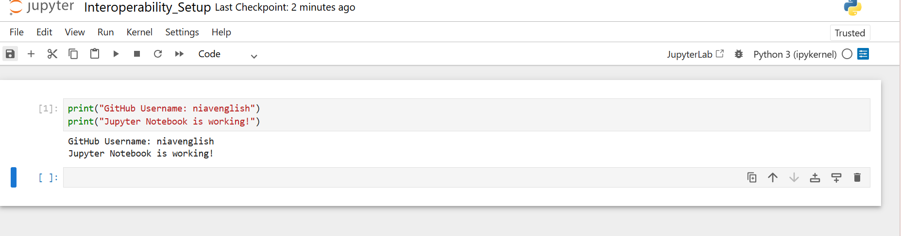
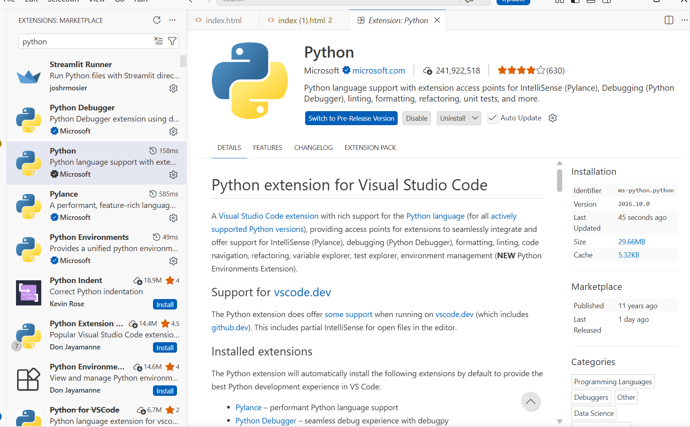
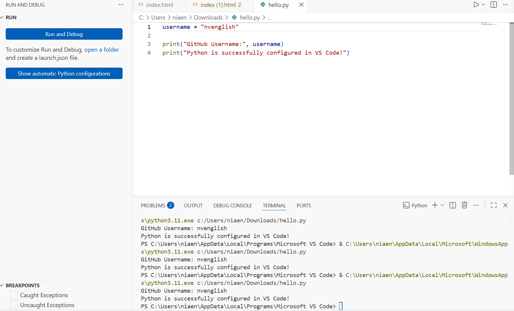

# INFOU762-01

**Student:** Nia Victoria English  
**GitHub Username:** niavenglish  
**Course:** Interoperability 762-01

## Assignment Overview

The purpose of this assignment is to set up the tools needed for Python programming and future interoperability projects. This includes creating a GitHub repository, installing Anaconda and Jupyter Notebook, and configuring VS Code to run Python.

## Tools Installed

### 1. GitHub
Created a GitHub repository to document my coursework and programming projects.

### 2. Anaconda
Installed Anaconda to manage Python and development environments.

### 3. Jupyter Notebook
Installed and tested Jupyter Notebook by running a simple Python program.

### 4. Visual Studio Code
Installed Visual Studio Code as my code editor.

### 5. Python Configuration in VS Code
Installed the Microsoft Python extension, selected a Python interpreter, and successfully ran a Python program.

## Conclusion

I successfully set up the development tools required for this course.
